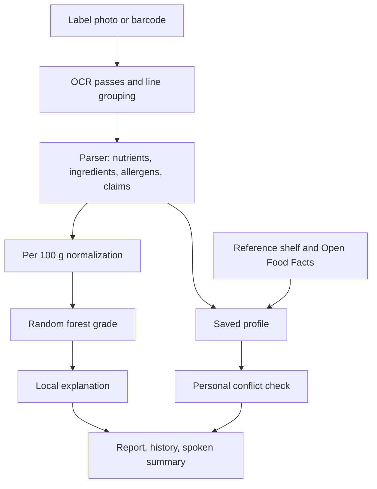

# NutriLens: Preference-Aware, Explainable Reading of Packaged Food Labels

**Authors:** Lovely Sharma  
**Affiliation:** TeamRocket.exe  
**Date:** 17 October 2026  
**Status:** Working paper accompanying the NutriLens / NutriTrust prototype

## Abstract

Packaged food labels split one decision across a marketing claim, a nutrition table, a serving size, and an ingredient list. NutriLens is a local, open-source pipeline that photographs a label, reads it with EasyOCR, normalizes nutrients to a per-100 g basis, predicts a Nutri-Score grade with a random forest trained on Open Food Facts, and checks the result against a shopper's saved allergens and diet screens. This paper describes the system as it stands after a round of corrections and product features: multi-pass image enhancement, reading-order reconstruction, refusal to invent missing nutrients, local explanations of the grade, a personal profile, a reference shelf of preference-matching foods, scan history, four interface languages, and controls for low vision and hearing access. The published model metrics are unchanged because the forest was not retrained. The practical gain is that a real zero is no longer replaced by a dataset median, explanations are local rather than global, and recommendations can name a conflict with the person who is about to eat the food. The shelf is a preference match. It is not a medical clearance.

## 1. Introduction

A front-of-pack claim and a nutrition table can describe the same product and still point a shopper in different directions. Serving sizes that are smaller than a usual portion make energy and sugar look modest. Additive codes and allergen declarations sit in type that is hard to read in a shop aisle. People who avoid milk, gluten, peanuts, or a high-salt pattern have to do that comparison themselves, often under time pressure.

NutriLens treats the label as evidence rather than as a slogan. The prototype already combined OCR, per-100 g normalization, a random-forest Nutri-Score classifier, rule-based nutrient screens, ingredient categories, claim checks, and a trust score. This revision makes that pipeline safer to use and usable by more than one kind of reader.

The product boundary is deliberate. The system may say that a claim is poorly supported by the extracted table, or that a saved allergen appears in the extracted text. It does not diagnose disease, prescribe a diet, accuse a manufacturer of fraud, or declare a food safe.

## 2. Related problems

Three failure modes show up repeatedly in practical OCR and in nutrition apps.

First, the photograph is the model. Dirty, small, tilted, or low-contrast labels fail before any classifier runs. Preprocessing and an honest confidence score matter more than swapping the recognizer [Groover, 2026].

Second, a barcode database is a useful second source when the photo is unreadable, not a replacement for reading the package in front of the shopper. Offline-first allergen tools already combine a local check with Open Food Facts as a fallback [Glutensa, 2026].

Third, a random forest's impurity importance answers "which column mattered during training," not "why this packet received grade C" [Rajput, 2026]. A local method is required. TreeSHAP is the preferred one. An occlusion against a stated baseline is an acceptable stand-in when the SHAP library is not installed.

## 3. System

NutriLens remains four processes:

| Process | Role | Default port |
| --- | --- | --- |
| Next.js web app | Landing page, kitchen studio, scan, report | 3000 |
| Express API | OCR proxy, analysis, profile and history store, barcode proxy | 4000 |
| FastAPI ML | Random-forest Nutri-Score and local explanation | 8000 |
| FastAPI OCR | EasyOCR, image passes, label parse | 8001 |

PostgreSQL still holds scans, label rows, claims, and reports through Prisma. Profile, scan memory, and the reference shelf also persist in the browser so the kitchen studio works when the database is down. When the API is up, profile and history are copied to `services/api/data/store.json`.

## 4. OCR

The OCR service keeps a cached EasyOCR reader per language set. English is always included so numerals and Latin nutrient names survive when a second language is requested. Supported codes are English, Hindi, French, Spanish, German, Tamil, Bengali, and Marathi. The interface language (English, Hindi, Spanish, French) is separate from the label language.

Each image is transposed from EXIF, upscaled when the long edge is under 1400 pixels, then read from a contrast-sharpened color pass. If the mean confidence is below 0.55 or fewer than eight boxes survive a 0.15 confidence floor, a grayscale autocontrast pass and the original pixels are read as well. Duplicate strings keep the higher confidence.

Boxes are then grouped into visual lines by vertical overlap and ordered left to right. That reconstructed text is what the ingredient and claim patterns see. Spatial pairing is unchanged in spirit: a nutrient word is matched to the nearest number on the same row to its right.

Three parser errors were removed because they manufactured nutrition:

- A daily reference such as "/2000 kcal" is no longer stored as the product's energy.
- The literal token "6 g" is no longer assumed to be total fat.
- A printed zero is a measured zero. Only a missing field may be imputed later.

Two conversions were added. Kilojoules are divided by 4.184 and reported as kilocalories, with the conversion named in the source text. If salt is absent and sodium is present, salt in grams is estimated as sodium grams times 2.5, which is the usual sodium-chloride factor. The source text says the salt figure was estimated. Hindi nutrient words and a wider allergen list (egg, fish, lactose, almond, cashew, crustacean, and others) are recognized. The product name is the first short non-nutrient line, not only a line that contains the word "crisps."

## 5. Grade model

The classifier is the existing `RandomForestClassifier` stored in `nutritrust_random_forest.joblib`. It was trained on Open Food Facts world food facts to predict `nutrition_grade_fr` from eight per-100 g features: energy, fat, saturated fat, carbohydrates, sugars, fiber, proteins, and salt. The evaluation recorded with that training run is:

| Metric | Value |
| --- | --- |
| Accuracy | 0.9487 |
| Balanced accuracy | 0.9461 |
| Macro F1 | 0.9467 |
| Weighted F1 | 0.9488 |
| ROC-AUC | 0.9960 |
| PR-AUC | 0.9853 |

Those numbers describe the held-out table task. They do not describe end-to-end accuracy on phone photographs, and this paper does not claim a new accuracy. The forest was not retrained.

What did change is the contract at inference. Previously every zero sent by the API was treated as "missing" and replaced by an Open Food Facts median (for example fiber 2.8 g, salt 0.7 g). A product that truly contains no fiber was silently moved toward the middle of the training set, which can change the grade. The API now sends `null` for absent nutrients and `0` for printed zeros. Only `null` is imputed, and the response lists `imputedFeatures`.

Nutrient screens are separate from the grade. They remain the existing thresholds: sugars 5 g / 22.5 g, saturated fat 1.5 g / 5 g, salt 0.3 g / 1.5 g, energy 250 kcal / 400 kcal per 100 g, reported as low, medium, or high screening levels. They are not a diagnosis.

### 5.1 Local explanation

For the predicted class, each feature is replaced in turn by its training median and the change in that class probability is recorded. A positive contribution means the real value increased the probability of the predicted grade relative to the median. This occlusion uses eight extra predictions and does not require another library.

If `shap` imports and `TreeExplainer` succeeds, those values are returned instead, with `method: "shap"`. If it does not, the response says `method: "occlusion"` and explains the baseline. The report draws one bar per feature. Global impurity importance is not shown as if it were a reason for this packet.

## 6. Personal recommendations, shelf, and history

A profile stores a display name, allergens to avoid, and screens: vegan, vegetarian, Jain, low sugar (sugars at least 5 g/100 g), low salt (salt at least 0.3 g/100 g), high protein (protein under 10 g/100 g), and a flag for added colours or flavourings. It lives in `localStorage` and is sent with each analysis request. The API compares it with ingredient and OCR text.

A conflict produces a high-severity recommendation that names the overlap. A profile with allergens and no overlap produces an informational note that OCR may have missed a panel. Absence of a profile leaves the previous generic recommendations unchanged.

The safe shelf is twelve reference foods with published-style per-100 g values, allergen lists, and ingredient strings. A food is listed only when `assessFit` returns no reason. Reasons include an allergen hit, a diet-word hit, a nutrient screen miss, an additive flag, or screening grade D or E. Screening grade is a transparent point score on the same nutrient thresholds, minus a point for fiber at least 6 g or protein at least 12 g. It is labeled as a screening grade so it is not confused with the random-forest grade on a real scan.

Completed scans are kept on the device (up to 40) and posted to the API history (up to 50) when the API accepts them. The studio shows a pantry count: scans, profile conflicts, and current shelf matches.

A compare view places two reference foods side by side. A barcode field asks the API to query Open Food Facts (`/api/v2/product/{code}.json` with a NutriLens user agent) and then runs the same fit function. The browser tries the public API directly if the NutriLens API is down. Public database rows can be incomplete or stale. The fit sentence says the check used the available public record.

## 7. Language and access

Interface copy for the studio, navigation call to action, and the explanation panel is available in English, Hindi, Spanish, and French. Label OCR language is chosen separately.

Access controls, stored with the profile preferences:

- High contrast and two larger text steps.
- Reduced motion, which also skips the navbar entrance animation and uses an instant scroll to the report.
- System cursor instead of the decorative ring. The ring is also off for coarse pointers and for `prefers-reduced-motion`.
- Vision support turns on speech synthesis in `en-IN`, `hi-IN`, `es-ES`, or `fr-FR`, and speaks the shelf or the finished scan.
- Hearing support shows the same utterance as an on-screen caption. A visually hidden live region is always updated, so a screen reader is not dependent on the caption bar.
- A skip link targets the studio.
- Visible focus rings and `aria-pressed` on toggles.

Speech is an extra channel. No result is conveyed by sound alone.

## 8. What was verified

Parser checks on constructed lines confirmed that 400 mg of sodium becomes 1.0 g of estimated salt, a bare "6 g" is not stored as fat, and the product name is taken from the following non-nutrient line. The API and the web app both type-check with `tsc --noEmit`. In the browser, the kitchen studio rendered with profile, shelf, history, compare, and barcode tabs, plus language and access controls. Turning on milk wrote that allergen into local storage and set the toggle to pressed. The random forest was not re-scored on a new photograph set. End-to-end OCR still depends on EasyOCR model files and on the photo.

## 9. Limitations

- OCR still misses glare, handwriting, and severely curved bottles. Confidence is an average of boxes, not a calibrated probability of a correct table.
- Sodium-to-salt conversion assumes sodium chloride. It is wrong for some sodium compounds. The source text marks the estimate.
- Median imputation, when a field is truly missing, still moves the grade. The report now says which fields were filled.
- The reference shelf is a small authored set for demonstration. It is not a census of Indian packaged food and it can go stale.
- Open Food Facts coverage is uneven, and allergen tags are only as good as the contributor record.
- Profile matching is string containment. It will miss a synonym it has never seen and can still false-alarm on a shared stem.
- TreeSHAP runs only when the optional `shap` package imports. Otherwise the occlusion method is used and named.
- The 94.87% accuracy figure is not an end-to-end claim about photos, Hindi labels, or personal fit.
- Nothing here replaces a clinician, a dietitian, or the statutory allergen statement.

## 10. What to do next

A detailed backlog is kept with the product notes that accompany this paper's release. The highest-value studies are a photographed-label benchmark with field-level precision and recall, a calibrated confidence that abstains, and a shelf built from products the household has actually scanned and confirmed.

## References

Groover, M. "The Hidden Challenge of Building an OCR System That Works in the Real World." DEV, https://dev.to/michael_groover_1fe970a66/the-hidden-challenge-of-building-an-ocr-system-that-works-in-the-real-world-2i5j

Particual. "How I Built a Fast, Offline-First Gluten Detection PWA Using Web OCR & Open Food Facts." DEV, https://dev.to/particual_fa18b6a17d860df/how-i-built-a-fast-offline-first-gluten-detection-pwa-using-web-ocr-open-food-facts-26og

Rajput, S. "Feature Importance in Random Forests: The Company That Fired the Wrong Employee Because It Measured the Wrong Thing." DEV, https://dev.to/sachin_krrajput/feature-importance-in-random-forests-the-company-that-fired-the-wrong-employee-because-it-measured-3cdh

Open Food Facts. Product API v2. https://world.openfoodfacts.org

Nutri-Score and the Open Food Facts `nutrition_grade_fr` field, as used by the existing training metadata in this repository.
