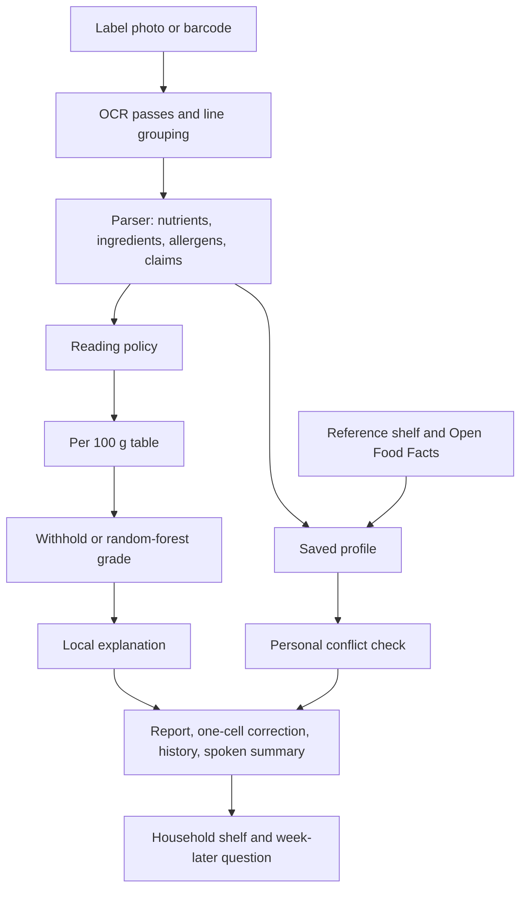

# NutriLens: Preference-Aware, Explainable Reading of Packaged Food Labels

**Authors:** Lovely Sharma  
**Affiliation:** TeamRocket.exe  
**Date:** 17 October 2026  
**Status:** Updated working paper for the NutriLens / NutriTrust prototype  
**Findings list:** `docs/research/NUTRILENS_FINDINGS.md`

## Abstract

Packaged food labels split one decision across a marketing claim, a nutrition table, a serving size, and an ingredient list. NutriLens is a local, open-source pipeline that photographs a label, reads it with EasyOCR, keeps a portion column apart from a per-100 g column, and predicts a Nutri-Score letter with a random forest trained on Open Food Facts. A missing or physically impossible nutrient withholds that letter. A printed zero is kept. The same report can name a conflict with a saved allergen or diet screen, compare the letter before and after one corrected cell, and file a confirmed scan on a household shelf.

The published model metrics are unchanged because the forest was not replaced. On the held-out nutrition-table task they are accuracy 0.9487, balanced accuracy 0.9461, macro F1 0.9467, weighted F1 0.9488, ROC-AUC 0.9960, and PR-AUC 0.9853. A field scorer now counts each nutrient as correct, missed, swapped, wrong unit, invented, or a plain wrong value. Five constructed text lines, one each in English, Hindi, Marathi, Tamil, and Bengali, each scored a single protein row as correct. Those lines are not photographs, and this paper does not turn them into an OCR accuracy.

The shelf and the household list are preference matches. They are not a medical clearance.

## 1. Introduction

A front-of-pack claim and a nutrition table can describe the same product and still point a shopper in different directions. Serving sizes that are smaller than a usual portion make energy and sugar look modest. Additive codes and allergen declarations sit in type that is hard to read in a shop aisle. People who avoid milk, gluten, peanuts, or a high-salt pattern have to do that comparison themselves, often under time pressure.

NutriLens treats the label as evidence rather than as a slogan. The prototype combines OCR, per-100 g normalization, a random-forest Nutri-Score classifier, rule-based nutrient screens, ingredient categories, claim checks, and a trust score. This revision changes the contract around that pipeline: the grade is refused when the reading is incomplete, the two readers disagree, or the numbers are physically impossible; errors are counted by field; a person can correct one cell; and a confirmed scan can be asked about again a week later.

The product boundary is deliberate. The system may say that a claim is poorly supported by the extracted table, or that a saved allergen appears in the extracted text. It does not diagnose disease, prescribe a diet, accuse a manufacturer of fraud, or declare a food safe.

## 2. Related problems

Four failure modes show up repeatedly in practical OCR and in nutrition apps.

First, the photograph is the model. Dirty, small, tilted, or low-contrast labels fail before any classifier runs. Preprocessing and an honest confidence score matter more than swapping the recognizer [Groover, 2026].

Second, a barcode database is a useful second source when the photo is unreadable, not a replacement for reading the package in front of the shopper. Offline-first allergen tools already combine a local check with Open Food Facts as a fallback [Glutensa, 2026]. A misread digit is a different product. Look-alike characters are a known weak point of recognizers [Hexisteme, 2026].

Third, a random forest's impurity importance answers which column mattered during training, not why this packet received grade C [Rajput, 2026]. A local method is required. TreeSHAP is the preferred one. An occlusion against a stated baseline is an acceptable stand-in when the SHAP library is not installed.

Fourth, a rules engine that can name a word but cannot score it tells the person the app exists for that nothing was assessed [Pertu, 2026]. NutriLens still matches allergens by string containment. The household follow-up exists so those misses can be counted from answers a person gives, rather than hidden inside a single "safe" label.

## 3. System

NutriLens is four processes:

| Process | Role | Default port |
| --- | --- | --- |
| Next.js web app | Landing page, dashboard, kitchen studio, scan, report, terms, copyright | 3000 |
| Express API | OCR proxy, analysis, profile and history store, barcode proxy, auth | 4000 |
| FastAPI ML | Random-forest grade, local explanation, health-screen flags | 8000 |
| FastAPI OCR | EasyOCR, image passes, label parse, reading policy | 8001 |

PostgreSQL holds scans, label rows, claims, and reports through Prisma. Profile, scan memory, the reference shelf, and the household shelf also persist in the browser so the studio works when the database is down. When the API is up, profile and history are copied to `services/api/data/store.json`.

## 4. OCR

The OCR service keeps a cached EasyOCR reader per language set. English is always included so numerals and Latin nutrient names survive when a second language is requested. Supported codes are English, Hindi, French, Spanish, German, Tamil, Bengali, and Marathi. The interface language (English, Hindi, Spanish, French) is separate from the label language.

Each image is transposed from EXIF, converted to RGB, and upscaled with Lanczos when the long edge is under 1400 pixels, to a long edge of 1400. The first pass uses contrast 1.55, sharpness 1.8, and a sharpen filter. If the mean confidence is below 0.55 or fewer than eight boxes survive, a grayscale autocontrast pass (cutoff 1) and the original pixels are read as well. Duplicate strings keep the higher confidence. The response reports `passes` as 1 or 3.

Boxes are grouped into visual lines by vertical overlap. The line tolerance is the maximum of 12 pixels and 0.65 times the median box height. Lines are ordered left to right. That reconstructed text is what the ingredient and claim patterns see. Spatial pairing matches a nutrient word to numbers on the same row to its right. If the amount is printed under the word, the nearest amount below is used. A bare numeral box is joined to a neighbouring unit box, so a split "9" and "g" can become 9 g. Amounts may use a space, "gm", "gram", or a comma decimal.

A nutrient name on its own line is paired with the next one or two lines when those lines contain only amounts. The phrase "per 100 g" is removed before the numbers are read, so the column heading is not stored as a nutrient. When the headings do not say which column is which, `column_order` is `unknown`. The screen may still show a left-number assumption, and section 4.1 withholds the grade.

The product name is the first short non-nutrient line (3 to 80 characters, with at least three Latin or Devanagari letters). It is not limited to a line that contains the word "crisps."

### 4.1 When the grade is withheld before the forest

`reading-policy-1` returns `abstain` for any of three signals. The reading stays on screen.

| Signal | Rule |
| --- | --- |
| `column_headings_missing` | `column_order` is `unknown` |
| `mean_box_confidence_low` | Mean box confidence is below 0.55 |
| `column_readers_disagree` | The line reader and the box reader disagree on a shared nutrient |

Mean box confidence is the average of EasyOCR box scores. The policy marks it `calibrated: false`. The 0.55 cutoff is the same heuristic that triggers a second image pass. It is not a probability that the table is correct, and the share of photographs that abstain has not been measured. The withheld sentence tells the shopper they can correct one cell and compare a new grade with the raw read.

## 5. What the parser will and will not store

Three parser errors were removed because they manufactured nutrition:

- A daily reference such as "/2000 kcal" is not stored as the product's energy.
- The literal token "6 g" is not assumed to be total fat.
- A printed zero is a measured zero. It is not treated as missing.

Two conversions are named in the source text:

- Kilojoules are divided by 4.184 and stored as kilocalories. When a row prints both kJ and kcal, the kcal figure is kept.
- If salt is absent and sodium is present, salt in grams is sodium grams times 2.5. Milligrams of sodium are divided by 1000 first. The source text says the salt figure was estimated. The 2.5 factor assumes sodium chloride.

`column_order` is one of `portion-then-100`, `100-then-portion`, `per100-only`, `portion-only`, or `unknown`. The grade uses the per-100 g figure. A portion-only salt value is not copied into the per-100 g salt field. When a gram serving is known, scaling is `per_100g = per_serving × (100 / serving_size_grams)`. If the serving size was not read, the API does not scale the table and does not fill a median.

Hindi, Marathi, Tamil, and Bengali protein words are recognized beside the English word: प्रोटीन, प्रथिने, புரதம், প্রোটিন. The allergen list matched by containment is milk, soy, wheat, gluten, barley, peanut, mustard, celery, sesame, nuts, almond, cashew, egg, fish, lactose, shellfish, and crustacean.

### 5.1 Field labels, kept separate

`services/ocr/app/field_score.py` labels each nutrient and refuses to collapse the counts into one accuracy percentage. `wrong_value` sits beside the five study labels so a plain wrong digit is not hidden inside `correct` or `invented`.

| Label | Meaning |
| --- | --- |
| `correct` | Portion and per-100 g value and unit match, within 1 kcal or 2% / 0.05 g |
| `missed` | Expected, and the parse has no value |
| `swapped` | The portion number and the per-100 g number traded places |
| `wrong_unit` | The number matches after mg/g or kJ/kcal conversion, or the unit is otherwise incompatible |
| `invented` | The parse has a value the answer key does not |
| `wrong_value` | A value is present and it is none of the above |

A unit check confirms the labels: protein 9 g / 18 g reversed is `swapped`; salt 1000 mg against 1 g is `wrong_unit`; an extra energy cell is `invented`; a missing fiber cell is `missed`; sugars 9 g against 5 g is `wrong_value`. The scored object has no `accuracy` field.

`services/ocr/benchmarks/constructed/` holds five text lines, not photographs. Each line is "per serving per 100 g", then the word for protein, then "9 g" and "18 g". Run on 17 October 2026, `score_constructed.py` labeled `proteins` as `correct` once in each of English, Hindi, Marathi, Tamil, and Bengali. Every other count was zero. That is one nutrient pattern in five scripts. It is not a language accuracy and not a photograph result. The scorer's own note says not to cite these counts as end-to-end precision or recall.

## 6. Grade model

The classifier is the existing `RandomForestClassifier` in `services/ml/nutritrust_random_forest.joblib`. Metadata records 200 estimators, unlimited depth, `max_features` `log2`, `min_samples_leaf` 1, `min_samples_split` 2, `class_weight` `balanced`, and `random_state` 42. The target is `nutrition_grade_fr` with classes a, b, c, d, and e. The eight features are `energy_100g`, `fat_100g`, `saturated-fat_100g`, `carbohydrates_100g`, `sugars_100g`, `fiber_100g`, `proteins_100g`, and `salt_100g`.

| Metric | Value |
| --- | --- |
| Accuracy | 0.9487 |
| Balanced accuracy | 0.9461 |
| Macro F1 | 0.9467 |
| Weighted F1 | 0.9488 |
| ROC-AUC | 0.9960 |
| PR-AUC | 0.9853 |

Those numbers describe the held-out table task from the training run that produced the published file. They do not describe phone photographs. `services/ml/train_forest.py` can train the same recipe from a CSV of at least 500 complete rows. Without `--replace` it does not overwrite the published joblib. This paper did not replace it.

### 6.1 Missing and impossible values

Earlier inference treated a zero as missing and replaced it with an Open Food Facts median, which can change the letter. The service now keeps a printed 0. A missing required feature returns HTTP 422 with reason `missing`. `imputedFeatures` is null.

Ceilings, shared by the API and the ML service: energy 900 kcal; fat, saturated fat, carbohydrates, sugars, fiber, and protein 100 g; salt 15 g. Saturated fat may not exceed total fat by more than 0.5 g. Sugars may not exceed carbohydrates by more than 0.5 g. An all-zero table is inside every ceiling. Salt at 20 g per 100 g is one plausibility issue, and the withheld sentence names it and says a median was not used.

### 6.2 Nutrient screens

Screens are separate from the forest. They are not a diagnosis.

| Nutrient | Medium | High |
| --- | --- | --- |
| Sugars | ≥ 5.0 g / 100 g | ≥ 22.5 g / 100 g |
| Saturated fat | ≥ 1.5 g / 100 g | ≥ 5.0 g / 100 g |
| Salt | ≥ 0.3 g / 100 g | ≥ 1.5 g / 100 g |
| Energy | ≥ 250 kcal / 100 g | ≥ 400 kcal / 100 g |

The shelf's screening grade adds 2 points for a high band and 1 for a medium band, then subtracts 1 when fiber is at least 6 g or protein is at least 12 g. Score 0 or below is A, 1 is B, 2 is C, 3–4 is D, and 5 or more is E. That letter is labeled a screening grade so it is not confused with the random-forest letter.

### 6.3 Local explanation

For the predicted class, each feature is replaced in turn by its training median and the change in that class probability is recorded. A positive contribution means the real value increased the probability of the predicted grade relative to the median. This occlusion uses eight extra predictions.

The medians are energy 380 kcal, fat 8.5 g, saturated fat 3.2 g, carbohydrates 20 g, sugars 5.5 g, fiber 2.8 g, protein 8 g, and salt 0.7 g. They are an explanation baseline. They are not written into the nutrient table.

If `shap` imports and `TreeExplainer` succeeds, those values are returned instead, with `method: "shap"`. Otherwise the response says `method: "occlusion"`. Global impurity importance is not shown as a reason for this packet.

### 6.4 One corrected cell

The dashboard portion table accepts an edit to one per-100 g cell. A second edit is refused so two corrections are not mixed into one comparison. The model is asked for the letter on the raw read and the letter after that single correction. Both can be a letter or a withheld reason. No set of those pairs has been collected, so this paper does not report how often one correction changes the grade.

## 7. Profile, shelves, and barcode

A profile stores a display name, allergens to avoid, and screens: vegan, vegetarian, Jain, a diabetic screen (sugars at least 5 g/100 g), low salt (salt at least 0.3 g/100 g), high protein (protein under 10 g/100 g), and a flag for added colours or flavourings. It lives in browser storage and is sent with analysis.

A conflict produces a high-severity recommendation that names the overlap. A profile with allergens and no overlap produces an informational note that OCR may have missed a panel. No usable profile leaves the generic recommendations unchanged. Matching is string containment. "Tree nuts" also matches almond, cashew, walnut, pistachio, or hazelnut. Vegan checks animal terms plus dairy, egg, and honey. Vegetarian and Jain check animal terms. Jain also checks onion, garlic, potato, carrot, and radish. Unseen synonyms are missed. A shared stem can false-alarm. Absence of a word in the OCR text is not absence of the allergen on the packet.

The trust score is the average of claim-verification scores. Status fallbacks are verified 1, uncertain 0.5, and flagged 0. Confidence is `min(number of verifications / 5, 1)`. With no verifications the overall score is null and confidence is 0. The score is not a safety percentage.

The reference shelf is twelve authored foods. A row is listed only when `assessFit` returns no reason: no allergen hit, no diet-word hit, no nutrient-screen miss, no additive flag, and no screening grade D or E. A compare view places two of those foods side by side. Twelve rows are a demonstration. They are not a census of Indian packaged food.

The household shelf is separate. A person confirms a finished scan. Seven days later the studio asks whether the preference check still agrees. `agreementSummary` counts only answers whose follow-up time has passed. No week-later answers are stored in this repository, so agreement is not yet a measured rate.

Barcode lookup accepts 8, 12, 13, or 14 digits and checks the GS1 check digit before any request. Weights alternate 3 and 1 from the right of the payload. A failed check is not looked up, and the message says a misread digit is a different product. A passing code is sent to Open Food Facts `/api/v2/product/{code}.json` with a NutriLens user agent, then through the same fit function. The browser tries the public API directly if the NutriLens API is down. Public rows can be incomplete or stale. The fit sentence says the check used the available public record.

Completed scans are kept on the device (up to 40) and posted to API history (up to 50) when the API accepts them.

## 8. Language, access, and account

Interface copy for the studio, the navigation call to action, and the explanation panel is available in English, Hindi, Spanish, and French. Label OCR language is chosen separately.

Access controls, stored with the profile preferences:

- High contrast and two larger text steps.
- Reduced motion, which also skips the navbar entrance animation and uses an instant scroll to the report.
- System cursor instead of the decorative ring. The ring is also off for coarse pointers and for `prefers-reduced-motion`.
- Vision support speaks the shelf or the finished scan in `en-IN`, `hi-IN`, `es-ES`, or `fr-FR`.
- Hearing support shows the same utterance as an on-screen caption. A visually hidden live region is always updated.
- A skip link targets the studio.
- Visible focus rings and `aria-pressed` on toggles.

Speech is an extra channel. No result is conveyed by sound alone.

Email sign-in exists. Forgot-password answers the same way whether or not that email is registered. Reset mail is attempted through InsForge and then SMTP. If neither sends, the reset code is shown on the reset page for this machine. `/terms` states the limits of a reading. `/copyright` names what belongs to this prototype and what stays with Open Food Facts and Nutri-Score. Those pages are not a filing or an approval. Login and captions do not change the nutrition model.

## 9. What was checked

| Check | Result |
| --- | --- |
| 400 mg sodium | 1.0 g estimated salt, source text names the estimate |
| Bare "6 g" | Not stored as fat |
| "Protein", then "9 g" and "18 g" | 9 g portion and 18 g per 100 g |
| "9 gm" | Read as grams |
| Heading "per 100 g" | Not stored as a nutrient |
| Portion salt 0.2 g on a 30 g serving, other nutrients already per 100 g | Salt stays undefined |
| Salt 20 g / 100 g | One plausibility issue; sentence refuses a median |
| All-zero table | Not implausible |
| Protein 9 g and 18 g reversed | Field label `swapped`; no accuracy field |
| Salt 1000 mg against 1 g | `wrong_unit` |
| Extra energy, missing fiber, sugars 9 g against 5 g | `invented`, `missed`, `wrong_value` |
| Abstain policy on unknown columns, confidence 0.4, and a protein disagreement | `abstain`, `calibrated: false`, all three reasons |
| Same policy with portion-then-100, confidence 0.8, no disagreement | `grade` |
| Five constructed protein lines (en, hi, mr, ta, bn) | Each `proteins` count is `correct` 1; every other count is 0 |
| API and web `tsc --noEmit` | Passed at the time of the earlier draft |
| Browser studio | Profile, shelf, history, compare, and barcode tabs rendered. Turning on milk wrote that allergen into local storage |

The random forest was not re-scored on a new photograph set. End-to-end OCR still depends on EasyOCR model files and on the photo.

## 10. What is still unmeasured

The tools in sections 4.1, 5.1, 6.4, and 7 exist. The study numbers do not. A later draft must not fill these gaps.

- No photographed packet has been scored, so field-level precision and recall on photos are unknown. Five correct constructed protein rows are not that measurement.
- The 0.55 abstain cutoff is uncalibrated. How often the prototype abstains, and how often a person looking at the same photo would abstain, is unknown.
- One-cell corrections can be compared. No corpus of those pairs is in the repository.
- The household question can record agreement a week later. No such answers are stored, so the agreement rate is unknown.
- Hindi, Tamil, Bengali, and Marathi have one constructed protein line each. They have not been scored as photographed sets.
- The terms and copyright pages describe the prototype. They are not an approval.

The highest-value measurements still missing are a photographed run of the field scorer, a calibration of the 0.55 cutoff, and week-later answers from a household.

## 11. Claims that stay in bounds

In bounds, with the task named in the same sentence: the held-out table metrics; grade refusal instead of median fill; the three abstain signals and the statement that confidence is uncalibrated; the six field labels and the five constructed protein rows; local explanation by occlusion or TreeSHAP; the screening thresholds; the sodium and kilojoule conversions; string-containment profile matching; the twelve-item shelf as a demonstration; the GS1 check before lookup.

Out of bounds: any new accuracy, F1, or OCR percentage; "safe", "cleared", "medical", "fraud", or "clinically validated"; a sentence that email login or the terms page improved nutrition performance; treating the screening grade and the random-forest grade as the same number; citing the constructed-line counts as end-to-end precision or recall.

## References

Groover, M. "The Hidden Challenge of Building an OCR System That Works in the Real World." DEV, https://dev.to/michael_groover_1fe970a66/the-hidden-challenge-of-building-an-ocr-system-that-works-in-the-real-world-2i5j

Particual. "How I Built a Fast, Offline-First Gluten Detection PWA Using Web OCR & Open Food Facts." DEV, https://dev.to/particual_fa18b6a17d860df/how-i-built-a-fast-offline-first-gluten-detection-pwa-using-web-ocr-open-food-facts-26og

Rajput, S. "Feature Importance in Random Forests: The Company That Fired the Wrong Employee Because It Measured the Wrong Thing." DEV, https://dev.to/sachin_krrajput/feature-importance-in-random-forests-the-company-that-fired-the-wrong-employee-because-it-measured-3cdh

Hexisteme. "The Dedicated OCR Engine Lost to the General-Purpose Model — 300× Slower." DEV, https://dev.to/hexisteme/the-dedicated-ocr-engine-lost-to-the-general-purpose-model-300x-slower-2bf7

Pertu, D. "450 label words the test suite will not let us ship without." DEV, https://dev.to/daniel_pertu/450-label-words-the-test-suite-will-not-let-us-ship-without-4102

Open Food Facts. Product API v2. https://world.openfoodfacts.org

Nutri-Score and the Open Food Facts `nutrition_grade_fr` field, as used by the training metadata in this repository.
