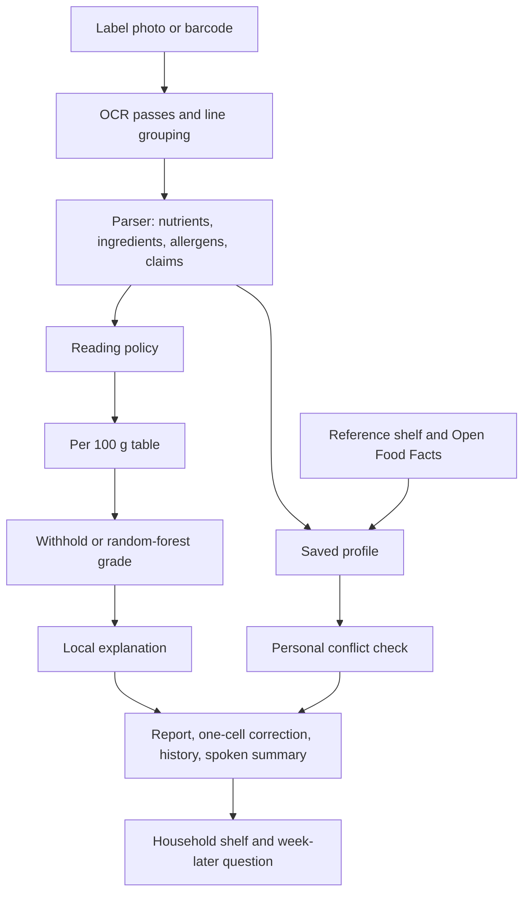

# NutriLens: Preference-Aware, Explainable Reading of Packaged Food Labels

**Authors:** Lovely Sharma  
**Affiliation:** TeamRocket.exe  
**Date:** 18 October 2026  
**Status:** Updated working paper for the NutriLens / NutriTrust prototype  
**Findings list:** `docs/research/NUTRILENS_FINDINGS.md`

## Abstract

Packaged food labels split one decision across a marketing claim, a nutrition table, a serving size, and an ingredient list. NutriLens is a local, open-source pipeline that photographs a label, reads it with EasyOCR, keeps a portion column apart from a per-100 g column, and predicts a Nutri-Score letter with a random forest trained on Open Food Facts. A missing or physically impossible nutrient withholds that letter. A printed zero is kept. The same report can name a conflict with a saved allergen or diet screen, compare the letter before and after one corrected cell, and file a confirmed scan on a household shelf.

The published model metrics are unchanged because the forest was not replaced. On the held-out nutrition-table task they are accuracy 0.9487, balanced accuracy 0.9461, macro F1 0.9467, weighted F1 0.9488, ROC-AUC 0.9960, and PR-AUC 0.9853. A field scorer now counts each nutrient as correct, missed, swapped, wrong unit, invented, or a plain wrong value. Constructed text lines in English, Hindi, Marathi, Tamil, and Bengali cover protein, sugars, salt, energy, and fat. On 18 October 2026 each language had five nutrients labeled correct, and every other field count was zero. Those lines are not photographs, and this paper does not turn them into an OCR accuracy.

A second letter is computed from the 2017 Nutri-Score general-foods point table, with fruit percent unknown and counted as zero. On 18 October 2026 that letter was compared with the shelf's screening grade and with the published forest. The comparison set is 984 complete tables whose energy is the 4/4/9/2 Atwater estimate, plus the twelve reference foods. It is not a photograph set and not a sample of Open Food Facts. The 984-table forest column was predicted by scikit-learn 1.9.1 from a joblib pickled with 1.6.1. That load warned the unpickle may be invalid. The twelve shelf letters from that load match the 1.6.1 record in the one-cell grid below. The 984-table forest letters were not re-run under 1.6.1. They do not replace the held-out table metrics above.

On the 984 tables the formula and the screening grade shared a letter on 542, differed by one letter on 390, and differed by two or more on 52. The formula and the forest shared a letter on 678, differed by one on 288, and differed by two or more on 18. All twelve reference foods were inside the Atwater rule that flags a gap only when it is above 10% and above 30 kcal. A constructed kilojoule-as-kilocalorie cohort of 282 tables, each still under the 900 kcal ceiling, was divergent on every row. That checks the rule. It is not a rate in the wild.

The shelf and the household list are preference matches. They are not a medical clearance.

On 18 October 2026 the same published forest was loaded with scikit-learn 1.6.1, the version recorded in the joblib, and probed on complete tables. Those tables are the twelve reference foods and eight constructed rows. They are not photographs. Each nutrient was multiplied by 0.5, 0.8, 0.9, 1.1, 1.2, and 1.5. A probe outside a ceiling was rejected and left out of the flip count. The forest letter matched the shelf screening letter on 6 of 12 reference foods and on 3 of 8 constructed tables. A 2017 general-foods Nutri-Score, with fruit percent counted as zero, matched the forest on 9 of the 12 foods and on 7 of the 8 constructed tables. One constructed table is forest A and screening D, three steps apart, and no accepted probe moves the forest letter. Flip counts are split by the gap between the top class probability and the runner-up. That gap is not a calibrated probability, and the flip share is not an OCR accuracy.

A separate declared factorial of 432 coherent tables, also scored with scikit-learn 1.6.1, is the chance-corrected comparison. Forest and screening share a letter on 145 of 432 tables. Observed agreement is 0.3356, chance agreement is 0.2133, and Cohen's kappa is 0.1555. The Wilson 95% interval on that share is 0.2927 to 0.3815. A linear weighted kappa, which counts a one-letter miss as a quarter of an A-versus-E miss, is 0.4617. Forest and screening stay within one letter on 386 of 432 tables. The screening letter is the odd one of the three on 194 tables, and the formula is the odd one on 4. A 1000-draw shuffle of the screening letters, seed 18, never reached the observed kappa. Forest and the 2017 formula share a letter on 335 of 432, with kappa 0.6918. The twelve-food match of 6 of 12 has a Wilson interval from 0.2538 to 0.7462, so it is not the headline. On the same 432 tables a one-cell probe moves the forest letter on 318 tables, and the flip share of accepted probes is 0.1997 in the close-margin bucket and 0.0171 in the wide-margin bucket. The grid is not a food sample and not a photograph set. Kappa measures agreement, not which letter is correct.

## 1. Introduction

A front-of-pack claim and a nutrition table can describe the same product and still point a shopper in different directions. Serving sizes that are smaller than a usual portion make energy and sugar look modest. Additive codes and allergen declarations sit in type that is hard to read in a shop aisle. People who avoid milk, gluten, peanuts, or a high-salt pattern have to do that comparison themselves, often under time pressure.

NutriLens treats the label as evidence rather than as a slogan. The prototype combines OCR, per-100 g normalization, a random-forest Nutri-Score classifier, rule-based nutrient screens, ingredient categories, claim checks, and a trust score. This revision changes the contract around that pipeline: the grade is refused when the reading is incomplete, the two readers disagree, or the numbers are physically impossible; errors are counted by field; a person can correct one cell; and a confirmed scan can be asked about again a week later.

The product boundary is deliberate. The system may say that a claim is poorly supported by the extracted table, or that a saved allergen appears in the extracted text. It does not diagnose disease, prescribe a diet, accuse a manufacturer of fraud, or declare a food safe.

## 2. Related problems

Four failure modes show up repeatedly in practical OCR and in nutrition apps.

First, the photograph is the model. Dirty, small, tilted, or low-contrast labels fail before any classifier runs. Preprocessing and an honest confidence score matter more than swapping the recognizer [Groover, 2026].

Second, a barcode database is a useful second source when the photo is unreadable, not a replacement for reading the package in front of the shopper. Offline-first allergen tools already combine a local check with Open Food Facts as a fallback [Glutensa, 2026]. A misread digit is a different product. Look-alike characters are a known weak point of recognizers [Hexisteme, 2026].

Third, a random forest's impurity importance answers which column mattered during training, not why this packet received grade C [Rajput, 2026]. A local method is required. TreeSHAP is the preferred one. An occlusion against a stated baseline is an acceptable stand-in when the SHAP library is not installed.

Fourth, a rules engine that can name a word but cannot score it tells the person the app exists for that nothing was assessed [Pertu, 2026]. NutriLens still matches allergens by string containment. The household follow-up exists so those misses can be counted from answers a person gives, rather than hidden inside a single "safe" label.

## 3. System

NutriLens is four processes:

| Process | Role | Default port |
| --- | --- | --- |
| Next.js web app | Landing page, dashboard, kitchen studio, scan, report, terms, copyright | 3000 |
| Express API | OCR proxy, analysis, profile and history store, barcode proxy, auth | 4000 |
| FastAPI ML | Random-forest grade, local explanation, health-screen flags | 8000 |
| FastAPI OCR | EasyOCR, image passes, label parse, reading policy | 8001 |

PostgreSQL holds scans, label rows, claims, and reports through Prisma. Profile, scan memory, the reference shelf, and the household shelf also persist in the browser so the studio works when the database is down. When the API is up, profile and history are copied to `services/api/data/store.json`.

## 4. OCR

The OCR service keeps a cached EasyOCR reader per language set. English is always included so numerals and Latin nutrient names survive when a second language is requested. Supported codes are English, Hindi, French, Spanish, German, Tamil, Bengali, and Marathi. The interface language (English, Hindi, Spanish, French) is separate from the label language.

Each image is transposed from EXIF, converted to RGB, and upscaled with Lanczos when the long edge is under 1400 pixels, to a long edge of 1400. The first pass uses contrast 1.55, sharpness 1.8, and a sharpen filter. If the mean confidence is below 0.55 or fewer than eight boxes survive, a grayscale autocontrast pass (cutoff 1) and the original pixels are read as well. Duplicate strings keep the higher confidence. The response reports `passes` as 1 or 3.

Boxes are grouped into visual lines by vertical overlap. The line tolerance is the maximum of 12 pixels and 0.65 times the median box height. Lines are ordered left to right. That reconstructed text is what the ingredient and claim patterns see. Spatial pairing matches a nutrient word to numbers on the same row to its right. If the amount is printed under the word, the nearest amount below is used. A bare numeral box is joined to a neighbouring unit box, so a split "9" and "g" can become 9 g. Amounts may use a space, "gm", "gram", or a comma decimal.

A nutrient name on its own line is paired with the next one or two lines when those lines contain only amounts. The phrase "per 100 g" is removed before the numbers are read, so the column heading is not stored as a nutrient. When the headings do not say which column is which, `column_order` is `unknown`. The screen may still show a left-number assumption, and section 4.1 withholds the grade.

The product name is the first short non-nutrient line (3 to 80 characters, with at least three Latin or Devanagari letters). It is not limited to a line that contains the word "crisps."

### 4.1 When the grade is withheld before the forest

`reading-policy-1` returns `abstain` for any of three signals. The reading stays on screen.

| Signal | Rule |
| --- | --- |
| `column_headings_missing` | `column_order` is `unknown` |
| `mean_box_confidence_low` | Mean box confidence is below 0.55 |
| `column_readers_disagree` | The line reader and the box reader disagree on a shared nutrient |

Mean box confidence is the average of EasyOCR box scores. The policy marks it `calibrated: false`. The 0.55 cutoff is the same heuristic that triggers a second image pass. It is not a probability that the table is correct, and the share of photographs that abstain has not been measured. The withheld sentence tells the shopper they can correct one cell and compare a new grade with the raw read.

## 5. What the parser will and will not store

Three parser errors were removed because they manufactured nutrition:

- A daily reference such as "/2000 kcal" is not stored as the product's energy.
- The literal token "6 g" is not assumed to be total fat.
- A printed zero is a measured zero. It is not treated as missing.

Two conversions are named in the source text:

- Kilojoules are divided by 4.184 and stored as kilocalories. When a row prints both kJ and kcal, the kcal figure is kept.
- If salt is absent and sodium is present, salt in grams is sodium grams times 2.5. Milligrams of sodium are divided by 1000 first. The source text says the salt figure was estimated. The 2.5 factor assumes sodium chloride.

`column_order` is one of `portion-then-100`, `100-then-portion`, `per100-only`, `portion-only`, or `unknown`. The grade uses the per-100 g figure. A portion-only salt value is not copied into the per-100 g salt field. When a gram serving is known, scaling is `per_100g = per_serving × (100 / serving_size_grams)`. If the serving size was not read, the API does not scale the table and does not fill a median.

Hindi, Marathi, Tamil, and Bengali protein words are recognized beside the English word: प्रोटीन, प्रथिने, புரதம், প্রোটিন. The allergen list matched by containment is milk, soy, wheat, gluten, barley, peanut, mustard, celery, sesame, nuts, almond, cashew, egg, fish, lactose, shellfish, and crustacean.

### 5.1 Field labels, kept separate

`services/ocr/app/field_score.py` labels each nutrient and refuses to collapse the counts into one accuracy percentage. `wrong_value` sits beside the five study labels so a plain wrong digit is not hidden inside `correct` or `invented`.

| Label | Meaning |
| --- | --- |
| `correct` | Portion and per-100 g value and unit match, within 1 kcal or 2% / 0.05 g |
| `missed` | Expected, and the parse has no value |
| `swapped` | The portion number and the per-100 g number traded places |
| `wrong_unit` | The number matches after mg/g or kJ/kcal conversion, or the unit is otherwise incompatible |
| `invented` | The parse has a value the answer key does not |
| `wrong_value` | A value is present and it is none of the above |

A unit check confirms the labels: protein 9 g / 18 g reversed is `swapped`; salt 1000 mg against 1 g is `wrong_unit`; an extra energy cell is `invented`; a missing fiber cell is `missed`; sugars 9 g against 5 g is `wrong_value`. The scored object has no `accuracy` field.

`services/ocr/benchmarks/constructed/` holds text lines, not photographs. The original five lines are "per serving per 100 g", then the word for protein, then "9 g" and "18 g". Twenty further lines use the same shape for sugars, salt, energy, and fat, in English, Hindi, Marathi, Tamil, and Bengali, with the nutrient words already listed in the parser. Run on 18 October 2026, `score_constructed.py` labeled five nutrients `correct` in each of those five languages. Every other count was zero. That is five nutrient patterns in five scripts. It is not a language accuracy and not a photograph result. The scorer's own note says not to cite these counts as end-to-end precision or recall.

## 6. Grade model

The classifier is the existing `RandomForestClassifier` in `services/ml/nutritrust_random_forest.joblib`. Metadata records 200 estimators, unlimited depth, `max_features` `log2`, `min_samples_leaf` 1, `min_samples_split` 2, `class_weight` `balanced`, and `random_state` 42. The target is `nutrition_grade_fr` with classes a, b, c, d, and e. The eight features are `energy_100g`, `fat_100g`, `saturated-fat_100g`, `carbohydrates_100g`, `sugars_100g`, `fiber_100g`, `proteins_100g`, and `salt_100g`.

| Metric | Value |
| --- | --- |
| Accuracy | 0.9487 |
| Balanced accuracy | 0.9461 |
| Macro F1 | 0.9467 |
| Weighted F1 | 0.9488 |
| ROC-AUC | 0.9960 |
| PR-AUC | 0.9853 |

Those numbers describe the held-out table task from the training run that produced the published file. They do not describe phone photographs. `services/ml/train_forest.py` can train the same recipe from a CSV of at least 500 complete rows. Without `--replace` it does not overwrite the published joblib. This paper did not replace it.

### 6.1 Missing and impossible values

Earlier inference treated a zero as missing and replaced it with an Open Food Facts median, which can change the letter. The service now keeps a printed 0. A missing required feature returns HTTP 422 with reason `missing`. `imputedFeatures` is null.

Ceilings, shared by the API and the ML service: energy 900 kcal; fat, saturated fat, carbohydrates, sugars, fiber, and protein 100 g; salt 15 g. Saturated fat may not exceed total fat by more than 0.5 g. Sugars may not exceed carbohydrates by more than 0.5 g. An all-zero table is inside every ceiling. Salt at 20 g per 100 g is one plausibility issue, and the withheld sentence names it and says a median was not used.

### 6.2 Nutrient screens

Screens are separate from the forest. They are not a diagnosis.

| Nutrient | Medium | High |
| --- | --- | --- |
| Sugars | ≥ 5.0 g / 100 g | ≥ 22.5 g / 100 g |
| Saturated fat | ≥ 1.5 g / 100 g | ≥ 5.0 g / 100 g |
| Salt | ≥ 0.3 g / 100 g | ≥ 1.5 g / 100 g |
| Energy | ≥ 250 kcal / 100 g | ≥ 400 kcal / 100 g |

The shelf's screening grade adds 2 points for a high band and 1 for a medium band, then subtracts 1 when fiber is at least 6 g or protein is at least 12 g. Score 0 or below is A, 1 is B, 2 is C, 3–4 is D, and 5 or more is E. That letter is labeled a screening grade so it is not confused with the random-forest letter.

### 6.3 Local explanation

For the predicted class, each feature is replaced in turn by its training median and the change in that class probability is recorded. A positive contribution means the real value increased the probability of the predicted grade relative to the median. This occlusion uses eight extra predictions.

The medians are energy 380 kcal, fat 8.5 g, saturated fat 3.2 g, carbohydrates 20 g, sugars 5.5 g, fiber 2.8 g, protein 8 g, and salt 0.7 g. They are an explanation baseline. They are not written into the nutrient table.

If `shap` imports and `TreeExplainer` succeeds, those values are returned instead, with `method: "shap"`. Otherwise the response says `method: "occlusion"`. Global impurity importance is not shown as a reason for this packet.

### 6.4 One corrected cell

The dashboard portion table accepts an edit to one per-100 g cell. A second edit is refused so two corrections are not mixed into one comparison. The model is asked for the letter on the raw read and the letter after that single correction. Both can be a letter or a withheld reason. No set of corrections a person typed is in the repository. Section 6.5 is a different measurement: a fixed grid on complete tables, not those typed corrections.

### 6.5 One-cell grid on complete tables

`services/ml/evaluate_findings.py` writes `apps/web/app/lib/letter-stability.json`. The cited run used scikit-learn 1.6.1. The same script under 1.9.1 printed the same summary counts; 1.6.1 is cited because that is the version that pickled the forest. The forest file was not replaced.

Margin is the predicted-class probability minus the next class. Close means margin below 0.15, mid means below 0.40, and wide means 0.40 or more. A flip is an accepted probe whose letter differs from the unperturbed table.

| Corpus | Tables | Forest matches screening | Mean letter steps | Accepted probes | Flips | Rejected |
| --- | --- | --- | --- | --- | --- | --- |
| Reference shelf | 12 | 6 | 0.5 | 564 | 6 | 12 |
| Constructed tables | 8 | 3 | 0.875 | 382 | 11 | 2 |

Every shelf mismatch is one step. Five of those six screening letters are one step harsher than the forest. Almond drink is the other way: forest B, screening A. The three shelf foods with any flip all move first on saturated fat: plain dahi ×1.5 (2.8 g to 4.2 g, A to B), peanut butter ×0.5 (9 g to 4.5 g, C to A), and jaggery cookies ×1.1 (9 g to 9.9 g, D to E). The peanut-butter flip moves away from the screening letter D. The cookie flip lands on it. The nearest flip is not a path toward the screening letter.

| Margin bucket | Reference shelf | Constructed tables |
| --- | --- | --- |
| Close, margin < 0.15 | 0 tables | 1 table, 7 of 48 accepted probes flip |
| Mid, 0.15 to < 0.40 | 2 tables, 5 of 95 accepted probes flip | 1 table, 3 of 47 accepted probes flip |
| Wide, margin ≥ 0.40 | 10 tables, 1 of 469 accepted probes flip | 6 tables, 1 of 287 accepted probes flip |

Flip share is split by margin because one rate mixes a saturated letter with a close call [Parshvi, 2026]. The shelf aggregate, 6 flips in 564 accepted probes, is mostly the wide bucket. The one close constructed table, `two-medium`, accounts for 7 of the 11 constructed flips. A printed fiber of 0 stays 0 under every factor, so those probes cannot move fiber. They are counted as stable. They are not a stress test of a zero.

### 6.6 Three letters on the same table

The report can show three letters. The forest letter is the published classifier. The screening letter is the traffic-light score in section 6.2. The formula letter is the 2017 general-foods Nutri-Score in `apps/web/app/lib/readingAudit.ts`.

The formula converts kilocalories to kilojoules by multiplying by 4.184, and salt grams to sodium milligrams by dividing by 2.5 and multiplying by 1000. Points use the published thresholds and count a value only when it is strictly above the threshold. Fruit, vegetable, and nut percent is unknown and counted as 0, so protein points are dropped when negative points are 11 or more. Beverages, cheeses, and added fats are not scored on their own tables. The formula letter is not the forest letter.

A separate energy check estimates kilocalories as 4×protein + 4×carbohydrate + 9×fat + 2×fiber. Alcohol and polyols are omitted. The check flags a table when the gap is above 10% and above 30 kcal. It does not decide which figure is wrong, and the formula letter still uses the stated energy.

On the reference shelf, 0 of 12 tables are flagged. The formula letter matches the screening letter on 9 of 12 and the forest on 9 of 12. Six foods agree on all three letters. Brown rice, plain dahi, and almond drink have the formula with the forest and against the screen. Peanut butter, masala chips, and jaggery cookies have the formula with the screen and against the forest.

On the constructed tables, 4 of 8 are flagged by the energy check, and their formula letters were still computed. The formula matches the forest on 7 of 8 and the screening letter on 3 of 8. `protein-offset` is forest A, formula A, and screening D. Its forest margin is 0.82, and no accepted probe moves the forest letter. `two-medium` is the only table where all three letters differ: forest B, screening C, formula A. Its energy check is flagged.

### 6.7 A declared lattice of 984 coherent tables

Sections 6.5 and 6.6 use 20 complete tables. This section uses a larger declared lattice so the same three letters can be counted off a grid whose shape is written down. It is still not a sample of packaged food and not a photograph set. The script is `services/ml/audit_readings.py`. The counts are in `docs/research/reading-audit.json`, from the run on 18 October 2026.

Energy on the coherent lattice is the 4/4/9/2 estimate, rounded to 0.1 kcal, so the Atwater rule is expected to pass. Protein is 2, 8, 16, or 25 g. Carbohydrate is 5, 20, 45, or 70 g. Sugars are 5%, 40%, or 90% of carbohydrate. Fat is 1, 8, 20, or 40 g. Saturated fat is 20% or 60% of fat. Fibre is 0, 3, or 8 g. A row is dropped when fat, carbohydrate, and protein sum to more than 100 g, or when those three plus fibre sum to more than 105 g. Salt is `0.05 + 0.15 × the saturated-fat fraction + 0.02 × protein`, so salt is not its own axis. 984 tables remain. All 984 are inside the Atwater rule.

| Comparison on the 984 tables | Same letter | One letter apart | Two or more apart |
| --- | ---: | ---: | ---: |
| Formula vs screening grade | 542 | 390 | 52 |
| Formula vs forest, scikit-learn 1.9.1 | 678 | 288 | 18 |

Where the forest letter differed, it was usually the better letter. Of 130 formula-B tables, the forest said A on 76. Of 307 formula-D tables, it said C on 141. Of 46 formula-E tables, it said D on 37 and E on 9. The 18 wider gaps are formula C read as forest A. Formula A agreed on 282 of 283 tables.

Protein points were counted on 500 tables and dropped on 484, because negative points reached 11 while fruit percent stayed 0.

The formula margin is the number of Nutri-Score points from the score to the nearest other letter. Median margin is 2, minimum 1, maximum 9. Bins: 1 point on 293 tables, 2 on 247, 3 to 5 on 381, and 6 or more on 63. The forest matched the formula on 163 of the 293 one-point tables, and on 88 of the 94 tables whose margin was 5 or more. That margin is a point distance on the foods table. It is not the probability margin in section 6.5.

For each nutrient, the audit searches the smallest in-ceiling change that moves the formula letter. Steps are 1 kcal, 0.1 g, and 0.01 g of salt. Among tables where that nutrient could move the letter, the median change was 129.5 kcal of energy (976 tables), 6.9 g of sugars (654), 2.0 g of saturated fat (732), 0.49 g of salt (949), 2.1 g of fibre (666), and 6.4 g of protein (372). A median in grams and a median in kilocalories are different units.

An all-zero table, which is outside this lattice, scores 0 on the foods table and is letter B. The screening grade of that same table is A.

A unit-swap cohort stores the Atwater estimate times 4.184 in the kilocalorie cell and keeps the row only when that value is still at or under 900 kcal. 282 tables qualify. All 282 are divergent. The cohort was built to fail the rule, and the rule flagged every row. That is a check of the threshold, not a prevalence.

The scan report names the formula letter, the screening letter, the point margin, the Atwater gap, and those one-nutrient moves. When a portion energy was read, the same double threshold compares that portion scaled to 100 g with the per-100 g column. The studio shows both letters on the reference shelf, in the compare table, and on a barcode hit. A barcode hit says that a missing public nutrient is already stored as 0, because an all-zero foods table would otherwise be announced as B.

### 6.8 Chance-corrected agreement on 432 declared tables

Section 6.7 counts raw letter matches on a lattice where salt is not its own axis, and its forest column was loaded with scikit-learn 1.9.1. This section is a different grid. It was scored with scikit-learn 1.6.1, the version recorded in the joblib. The published forest was not replaced. The script is `services/ml/evaluate_factorial.py`. The counts are in `apps/web/app/lib/factorial-agreement.json`, from the run on 18 October 2026.

Sugars are 2, 8, or 24 g. Saturated fat is 0.5, 2.5, or 8 g. Salt is 0.1, 0.6, or 1.8 g, and it is its own axis. Fibre is 1 or 7 g. Protein is 4 or 14 g. Fat is saturated fat plus 4 g or 10 g. Carbohydrate is sugars plus 12 g or 35 g. Energy is 4×protein + 4×carbohydrate + 9×fat + 2×fiber. That is 432 tables. The energy check flags 0 of 432 because energy is the estimate. The grid is not a sample of packaged food and not a photograph set.

Cohen's kappa is (observed agreement − chance agreement) / (1 − chance agreement). Chance agreement is the sum, over the five letters, of the product of the two readers' shares of that letter. Kappa measures how often the letters match beyond that chance. It does not say which letter is the right one. Landis and Koch words for a kappa band are a label, not a cutoff. Each Wilson interval uses z = 1.96 and is an interval on the share of tables that share a letter. It is not an interval on kappa.

| Pair | Same letter | Observed | Chance | Kappa | Wilson 95% on the observed share | Mean letter steps | Second letter harsher by two or more | Second letter milder by two or more |
| --- | ---: | ---: | ---: | ---: | --- | ---: | ---: | ---: |
| Forest, then screening | 145 of 432 | 0.3356 | 0.2133 | 0.1555 | 0.2927 to 0.3815 | 0.7755 | 45 | 1 |
| Forest, then formula | 335 of 432 | 0.7755 | 0.2716 | 0.6918 | 0.7338 to 0.8123 | 0.2292 | 1 | 1 |
| Screening, then formula | 198 of 432 | 0.4583 | 0.2255 | 0.3006 | 0.4119 to 0.5055 | 0.5648 | 0 | 10 |

All three letters agree on 141 of 432 tables (0.3264; Wilson 0.2839 to 0.372). Kappa in this table is a pair measure. The three-way figure is a count.

Letter counts on the 432 tables: forest A 111, B 45, C 169, D 105, E 2; screening A 51, B 63, C 85, D 160, E 73; formula A 88, B 57, C 146, D 130, E 11. Screening sits further toward D and E. Forest and screening therefore agree only a little beyond chance. Forest and the formula agree much more often, and the chance correction still leaves kappa at 0.6918.

Unweighted kappa treats an A-versus-B miss the same as an A-versus-E miss. Linear weighted kappa does not. The weight of a miss is the letter distance divided by 4, so a one-letter miss has weight 0.25 and an A-versus-E miss has weight 1. On forest versus screening that weighted kappa is 0.4617. The two letters are within one step on 386 of 432 tables (0.8935; Wilson 0.8609 to 0.9192). The largest off-diagonal cell is forest C with screening D, 104 tables, then forest D with screening E, 63 tables. Both are one step, and both make the screening letter the harsher one.

When the three letters are not identical, the screening letter is the odd one on 194 tables, the forest on 57, and the formula on 4. All three differ on 36 tables. The formula almost never stands alone.

A shuffle of the screening letters, 1000 draws, seed 18, keeps both letter frequencies and breaks the pairing. The null median kappa is −0.0004. The 95th percentile is 0.0408. None of the 1000 draws reached the observed kappa of 0.1555. The exact-letter agreement is small, and it is not a frequency accident. The weighted figure says most of what remains is a one-letter shift. Neither figure says which letter is correct. A kappa of 0.80 is not a pass mark on this grid.

On the twelve reference foods, forest and screening agree on 6 of 12. Observed agreement is 0.5, chance agreement is 0.3472, kappa is 0.234, and the Wilson interval is 0.2538 to 0.7462. An interval that wide cannot be the cited comparison.

The same one-cell factors as section 6.5 were applied to every table. A probe moves the forest letter on 318 of 432 tables (0.7361; Wilson 0.6926 to 0.7755). Close margin, under 0.15: 896 flips in 4486 accepted probes (0.1997), and 93 of 94 tables flip. Mid margin, under 0.40: 252 of 5374 (0.0469), and 101 of 113 tables flip. Wide margin, 0.40 or more: 184 of 10732 (0.0171), and 124 of 225 tables flip. The nearest accepted flip is saturated fat on 113 tables, salt on 90, and sugars on 78. The shelf in section 6.5 has no close-margin food, which is why its aggregate flip share is small. This grid contains close margins, and the flip share falls as the margin widens. The margin is still not a calibrated probability.

## 7. Profile, shelves, and barcode

A profile stores a display name, allergens to avoid, and screens: vegan, vegetarian, Jain, a diabetic screen (sugars at least 5 g/100 g), low salt (salt at least 0.3 g/100 g), high protein (protein under 10 g/100 g), and a flag for added colours or flavourings. It lives in browser storage and is sent with analysis.

A conflict produces a high-severity recommendation that names the overlap. A profile with allergens and no overlap produces an informational note that OCR may have missed a panel. No usable profile leaves the generic recommendations unchanged. Matching is string containment. "Tree nuts" also matches almond, cashew, walnut, pistachio, or hazelnut. Vegan checks animal terms plus dairy, egg, and honey. Vegetarian and Jain check animal terms. Jain also checks onion, garlic, potato, carrot, and radish. Unseen synonyms are missed. A shared stem can false-alarm. Absence of a word in the OCR text is not absence of the allergen on the packet.

A twelve-line fixture in `apps/web/app/lib/matcher-audit.ts` names those modes. Four lines are hits: milk powder, almonds against tree nuts, mustard seeds, and chicken stock against vegetarian. Three lines are misses: casein, whey protein, and groundnut oil. Three lines are false alarms: coconut milk, gluten-free oats, and peanut-free sauce. Two lines stay clear: rice, and chickpeas against soy and vegan. The fixture is twelve constructed strings. It is not a corpus of photographed ingredient lists.

The trust score is the average of claim-verification scores. Status fallbacks are verified 1, uncertain 0.5, and flagged 0. Confidence is `min(number of verifications / 5, 1)`. With no verifications the overall score is null and confidence is 0. The score is not a safety percentage.

The reference shelf is twelve authored foods. A row is listed only when `assessFit` returns no reason: no allergen hit, no diet-word hit, no nutrient-screen miss, no additive flag, and no screening grade D or E. Each card names the screening grade and the 2017 formula letter separately. A compare view places two of those foods side by side, including both letters. Twelve rows are a demonstration. They are not a census of Indian packaged food. The formula letters for these twelve rows are in section 6.6. The 984-table lattice is in section 6.7. The chance-corrected 432-table grid is in section 6.8.

The household shelf is separate. A person confirms a finished scan. Seven days later the studio asks whether the preference check still agrees. `agreementSummary` counts only answers whose follow-up time has passed. No week-later answers are stored in this repository, so agreement is not yet a measured rate.

Barcode lookup accepts 8, 12, 13, or 14 digits and checks the GS1 check digit before any request. Weights alternate 3 and 1 from the right of the payload. A failed check is not looked up, and the message says a misread digit is a different product. A passing code is sent to Open Food Facts `/api/v2/product/{code}.json` with a NutriLens user agent, then through the same fit function. The browser tries the public API directly if the NutriLens API is down. Public rows can be incomplete or stale. The fit sentence says the check used the available public record.

Completed scans are kept on the device (up to 40) and posted to API history (up to 50) when the API accepts them.

## 8. Language, access, and account

Interface copy for the studio, the navigation call to action, and the explanation panel is available in English, Hindi, Spanish, and French. Label OCR language is chosen separately.

Access controls, stored with the profile preferences:

- High contrast and two larger text steps.
- Reduced motion, which also skips the navbar entrance animation and uses an instant scroll to the report.
- System cursor instead of the decorative ring. The ring is also off for coarse pointers and for `prefers-reduced-motion`.
- Vision support speaks the shelf or the finished scan in `en-IN`, `hi-IN`, `es-ES`, or `fr-FR`.
- Hearing support shows the same utterance as an on-screen caption. A visually hidden live region is always updated.
- A skip link targets the studio.
- Visible focus rings and `aria-pressed` on toggles.

Speech is an extra channel. No result is conveyed by sound alone.

Email sign-in exists. Forgot-password answers the same way whether or not that email is registered. Reset mail is attempted through InsForge and then SMTP. If neither sends, the reset code is shown on the reset page for this machine. `/terms` states the limits of a reading. `/copyright` names what belongs to this prototype and what stays with Open Food Facts and Nutri-Score. Those pages are not a filing or an approval. Login and captions do not change the nutrition model.

## 9. What was checked

| Check | Result |
| --- | --- |
| 400 mg sodium | 1.0 g estimated salt, source text names the estimate |
| Bare "6 g" | Not stored as fat |
| "Protein", then "9 g" and "18 g" | 9 g portion and 18 g per 100 g |
| "9 gm" | Read as grams |
| Heading "per 100 g" | Not stored as a nutrient |
| Portion salt 0.2 g on a 30 g serving, other nutrients already per 100 g | Salt stays undefined |
| Salt 20 g / 100 g | One plausibility issue; sentence refuses a median |
| All-zero table | Not implausible |
| Protein 9 g and 18 g reversed | Field label `swapped`; no accuracy field |
| Salt 1000 mg against 1 g | `wrong_unit` |
| Extra energy, missing fiber, sugars 9 g against 5 g | `invented`, `missed`, `wrong_value` |
| Abstain policy on unknown columns, confidence 0.4, and a protein disagreement | `abstain`, `calibrated: false`, all three reasons |
| Same policy with portion-then-100, confidence 0.8, no disagreement | `grade` |
| Five constructed protein lines, plus sugars, salt, energy, and fat in en, hi, mr, ta, bn | 18 October 2026: five `correct` nutrients in each language; every other count is 0. Text lines, not photographs |
| Coherent lattice, 984 tables | Formula vs screen 542 / 390 / 52. Formula vs forest 678 / 288 / 18. Atwater flags 0. See section 6.7 |
| Kilojoule stored as kilocalories, 282 tables under 900 kcal | Atwater flags all 282. A check of the rule, not a prevalence |
| One-cell grid, scikit-learn 1.6.1, 18 October 2026 | Shelf: forest matches screening on 6 of 12; 6 flips in 564 accepted probes, 12 rejected. Constructed: 3 of 8 match; 11 flips in 382 accepted probes, 2 rejected |
| Factorial grid, 432 tables, scikit-learn 1.6.1 | Forest–screening 145/432, chance 0.2133, kappa 0.1555, Wilson 0.2927–0.3815. Forest–formula kappa 0.6918. Energy check flags 0. See section 6.8 |
| Same grid, letter distance | Linear weighted kappa 0.4617. Within one letter: 386 of 432. Screening is the odd letter on 194 tables. Shuffle null, 1000 draws, never reached 0.1555 |
| Same 432 tables, one-cell probes | 318 of 432 tables flip. Close flip share 0.1997. Wide flip share 0.0171 |
| Shelf forest–screening, n = 12 | 6 of 12, kappa 0.234, Wilson 0.2538–0.7462. Too wide to be the headline |
| Matcher fixture, 12 constructed strings | 4 hits, 3 misses, 3 false alarms, 2 clears. `matcher-audit.test.ts` passed |
| Formula letter on those same tables | Shelf: formula matches forest on 9 of 12 and screening on 9 of 12; energy check flags 0. Constructed: formula matches forest on 7 of 8 and screening on 3 of 8; energy check flags 4 |
| API and web `tsc --noEmit` | Passed at the time of the earlier draft |
| Browser studio | Profile, shelf, history, compare, and barcode tabs rendered. Turning on milk wrote that allergen into local storage |

The random forest was not re-scored on a new photograph set. End-to-end OCR still depends on EasyOCR model files and on the photo.

## 10. What is still unmeasured

Sections 6.5 and 6.6 are measured on complete tables. The tools in sections 4.1, 5.1, and 7 still lack the measurements named below. A later draft must not fill those gaps.

- No photographed packet has been scored, so field-level precision and recall on photos are unknown. Five correct constructed protein rows are not that measurement.
- The 0.55 abstain cutoff is uncalibrated. How often the prototype abstains, and how often a person looking at the same photo would abstain, is unknown.
- The household question can record agreement a week later. No such answers are stored, so the agreement rate is unknown.
- A person can correct one cell and compare letters. No corpus of corrections a person typed is stored. The grid in section 6.5 is not that corpus.
- Hindi, Tamil, Bengali, and Marathi now have constructed lines for protein, sugars, salt, energy, and fat. They have not been scored as photographed sets. The 984-table lattice in section 6.7 is not a photograph set either, and its forest column was not re-run under scikit-learn 1.6.1. The 432-table grid in section 6.8 was run under 1.6.1. It does not replace the 984-table forest column, and it is not a photograph set.
- The twelve-line matcher fixture names hits, misses, and false alarms. It is not a photographed ingredient corpus.
- The terms and copyright pages describe the prototype. They are not an approval.

The highest-value measurements still missing are a photographed run of the field scorer, a calibration of the 0.55 cutoff, and week-later answers from a household. Sections 6.5, 6.6, 6.7, and 6.8 do not fill those gaps.

## 11. Claims that stay in bounds

In bounds, with the task named in the same sentence: the held-out table metrics; grade refusal instead of median fill; the three abstain signals and the statement that confidence is uncalibrated; the six field labels and the constructed text lines, five nutrients in five scripts; local explanation by occlusion or TreeSHAP; the screening thresholds; the 2017 general-foods formula with fruit percent counted as zero; the one-cell grid counts in section 6.5, including the margin buckets; the three-letter counts in section 6.6; the 984-table lattice and the 282-row unit-swap check in section 6.7, with the scikit-learn load named; the 432-table factorial in section 6.8, with kappa, chance agreement, and the Wilson interval on the matching share named together, and with the statement that the interval is not an interval on kappa; the linear weighted kappa, the within-one-letter count, the odd-reader counts, and the seeded shuffle null in that same section, with the weight defined as letter distance divided by 4; the twelve-line matcher fixture, with hits, misses, and false alarms counted separately; the sodium and kilojoule conversions; string-containment profile matching; the twelve-item shelf as a demonstration; the GS1 check before lookup.

Out of bounds: any new accuracy, F1, or OCR percentage; "safe", "cleared", "medical", "fraud", or "clinically validated"; a sentence that email login or the terms page improved nutrition performance; treating the screening grade, the formula letter, and the random-forest grade as the same number; citing the grid flip share without its margin bucket; citing 6 of 12, or 145 of 432, as an accuracy; citing kappa, weighted or unweighted, as a measure of which letter is correct, or treating 0.80 as a pass mark; citing the constructed-line counts, the matcher fixture, or either grid as end-to-end precision or recall.

## References

Groover, M. "The Hidden Challenge of Building an OCR System That Works in the Real World." DEV, https://dev.to/michael_groover_1fe970a66/the-hidden-challenge-of-building-an-ocr-system-that-works-in-the-real-world-2i5j

Particual. "How I Built a Fast, Offline-First Gluten Detection PWA Using Web OCR & Open Food Facts." DEV, https://dev.to/particual_fa18b6a17d860df/how-i-built-a-fast-offline-first-gluten-detection-pwa-using-web-ocr-open-food-facts-26og

Rajput, S. "Feature Importance in Random Forests: The Company That Fired the Wrong Employee Because It Measured the Wrong Thing." DEV, https://dev.to/sachin_krrajput/feature-importance-in-random-forests-the-company-that-fired-the-wrong-employee-because-it-measured-3cdh

Hexisteme. "The Dedicated OCR Engine Lost to the General-Purpose Model — 300× Slower." DEV, https://dev.to/hexisteme/the-dedicated-ocr-engine-lost-to-the-general-purpose-model-300x-slower-2bf7

Pertu, D. "450 label words the test suite will not let us ship without." DEV, https://dev.to/daniel_pertu/450-label-words-the-test-suite-will-not-let-us-ship-without-4102

Parshvi. "Flip Rate Lies When the Model Saturates: A Confidence-Stratified Methodology for Deletion-Based XAI Evaluation." DEV, https://dev.to/parshvi1508/flip-rate-lies-when-the-model-saturates-a-confidence-stratified-methodology-for-deletion-based-xai-4g7o

Kundalia, R. "Why 95 Reviews Beats 20 Reviews — Even When Both Score 95%." DEV, https://dev.to/rajkundalia/why-95-reviews-beats-20-reviews-even-when-both-score-95-2cp9

Peretz, O. "Inter-Rater Agreement and Cohen's Kappa: When Your Labels Are Opinions." DEV, https://dev.to/ofri-peretz/inter-rater-agreement-and-cohens-kappa-when-your-labels-are-opinions-2jdk

Wahiduddin, Faishal. "Calibrating an LLM-as-Judge for a Vision Check to κ 0.80." DEV, https://dev.to/faishalwahiduddin/calibrating-an-llm-as-judge-for-a-vision-check-to-k-080-2h50

B., Franck. "Auditing 857,655 Open Food Facts labels with pandas: how many nutrition facts contradict themselves?" DEV, https://dev.to/leanapp/auditing-857655-open-food-facts-labels-with-pandas-how-many-nutrition-facts-contradict-themselves-4cen

Regulation (EU) No 1169/2011, Annex XIV, conversion factors for the energy calculation.

Open Food Facts. Product API v2. https://world.openfoodfacts.org

Nutri-Score and the Open Food Facts `nutrition_grade_fr` field, as used by the training metadata in this repository.
